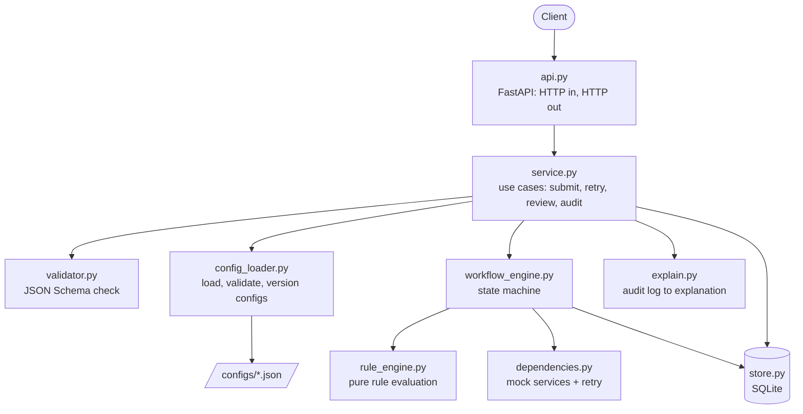
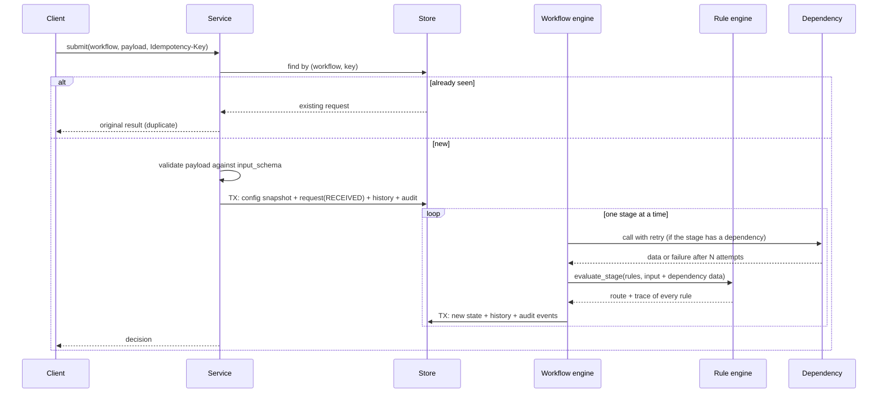
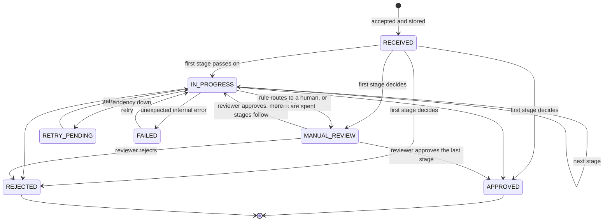

# Architecture

## 1. Problem understanding

The task is a **generic decision engine**, not a loan system. A business team should be able to describe a workflow (what a valid request looks like, which rules apply, in which stages, and where each outcome leads) in a config file, and the engine runs it. The engine must stay correct when things go wrong: a dependency is down, the same request arrives twice, the process dies half-way, or the rules change while requests are in flight.

**In scope**

- Intake with schema validation
- Rule evaluation: mandatory, threshold, conditional, multi-stage
- A state machine with approve, reject, retry and manual review outcomes
- Full state history and an audit trail that explains every decision
- Retries, idempotency, atomic saves, crash recovery
- Workflows and rules defined in JSON, reloadable without a restart
- One simulated external dependency per workflow, with fault injection

**Out of scope** (deliberately, see section 11)

- Authentication and authorisation
- Asynchronous workers and queues
- A UI
- A general-purpose expression language for rules

## 2. Design principles

1. **The engine knows how to run a workflow, never which workflow.** No file under `app/` mentions loans, vendors, PAN or credit scores except the mock dependencies.
2. **One module, one job.** Each module can be read, tested and replaced on its own.
3. **Dependencies point inward.** The API depends on the service; the service depends on the engines and the store. The rule engine depends on nothing.
4. **Fail closed, and say why.** A rule whose data is missing or of the wrong type is *indeterminate*, never true. An indeterminate check fails (mandatory, threshold) or goes to a human (conditional), and it stays indeterminate through `not`, `all` and `any`. Non-finite numbers are refused wherever data enters: request payloads and dependency responses. Section 6 has the exact semantics and section 13 the remaining gap.
5. **Nothing is decided without a trace.** The explanation is built from the audit log, never by re-running rules.

## 3. Components



| Module | Responsibility | Knows about |
|---|---|---|
| `api.py` | Parse HTTP, call one service method, map errors to status codes | service |
| `service.py` | The use cases; idempotency; orchestration | everything below |
| `validator.py` | Validate a payload against the workflow's JSON Schema; reject non-finite numbers | nothing |
| `config_loader.py` | Load and validate config files, hash them, serve the current version | rule engine (operator and rule-type names) |
| `workflow_engine.py` | Drive a request through stages; save each stage atomically | rule engine, dependencies, store |
| `rule_engine.py` | Evaluate one stage's rules; return route and trace | nothing (pure functions) |
| `dependencies.py` | Simulated external services, fault injection, retry with backoff, response checks | validator |
| `store.py` | Tables, transactions, optimistic locking | nothing |
| `explain.py` | Reshape audit events into a readable explanation | nothing |
| `errors.py` | Domain errors (no HTTP) | nothing |

The service layer is the seam that keeps the system open: a CLI, a queue consumer or a batch job would call the same `DecisionService` methods the REST API calls.

## 4. Data flow



## 5. Request lifecycle



**Manual review is a step, not an exit.** A reviewer's rejection is final. An approval clears the stage under review and the request moves to that stage's `on_pass` target, so later stages and their hard limits still run and may ask for a second review. A human step in the middle of a workflow (for example a manager sign-off between two automated stages) is modelled the same way: a rule that routes to `MANUAL_REVIEW` in a stage whose `on_pass` is the next stage.

`APPROVED` and `REJECTED` are final. Every state or stage change writes one row to `state_history` with the reason and the actor. The first stage can also park a request (`RETRY_PENDING`, `FAILED`) straight from `RECEIVED`; those arrows are left out of the diagram for readability.

One action changes no state and so writes no history row: taking over an abandoned request that is still `RECEIVED` or `IN_PROGRESS`. It is recorded as a `RECOVERED` audit event instead.

## 6. Configuration model

One JSON file per workflow in `configs/`. Annotated example:

```jsonc
{
  "workflow": "loan_approval",
  "version": 1,
  "max_resumes": 3,                       // how many times a parked request may be retried
  "input_schema": { ... },                // standard JSON Schema for the request body
  "stages": [                             // first stage in the list is the entry point
    {
      "id": "credit_check",
      "dependency": {                     // optional: data to fetch before the rules run
        "name": "credit_bureau",
        "input": { "applicant_id": "input.applicant_id" },   // parameter -> where it comes from
        "retry": { "max_attempts": 3, "backoff_ms": 100, "backoff_multiplier": 2 },
        "on_failure": "RETRY_PENDING"     // or MANUAL_REVIEW, REJECTED, FAILED
      },
      "rules": [
        { "id": "CREDIT-MIN", "type": "threshold",
          "field": "deps.credit_bureau.score", "op": ">=", "value": 650 },
        { "id": "CREDIT-BORDERLINE", "type": "conditional",
          "if": { "field": "deps.credit_bureau.score", "op": "<", "value": 700 },
          "then": "MANUAL_REVIEW" }
      ],
      "on_pass": "risk_assessment",       // a stage id, or APPROVED / REJECTED / MANUAL_REVIEW
      "on_fail": "REJECTED"
    }
  ]
}
```

**Rule types**

| Type | Meaning | Outcome |
|---|---|---|
| `mandatory` | `field` must be present and non-empty (null, blank or whitespace-only text, `[]` and `{}` count as missing) | fail routes to the rule's `on_fail`, else the stage's |
| `threshold` | `field op value` must hold. `value_ref` compares with another field instead of a constant, and `value_factor` scales it (`amount <= 10 x annual_income`) | same |
| `conditional` | if the `if` condition holds, route to `then` | no effect when it does not hold; `on_missing` when it cannot be evaluated |

**Missing data.** A comparison has three results: true, false, or indeterminate (its field is missing, null, empty, or of a type the operator cannot compare). Indeterminate propagates through `not`, `all` and `any` the way NULL does in SQL, so `not (blacklisted == true)` over a missing field is indeterminate, not true. Then:

- a `mandatory` or `threshold` rule **fails**;
- a `conditional` rule is recorded as `INDETERMINATE` and routes to its `on_missing` target. The default is `MANUAL_REVIEW`; a config can set a decision state, a stage, or `"IGNORE"` to treat it as not triggered.

A guard such as "if blacklisted, reject" therefore cannot be switched off by a typo in its path. Use `exists` / `not_exists` to test for presence on purpose.

**Dependency input mapping.** `dependency.input` maps the adapter's parameter names to data paths. An adapter names what it needs (`applicant_id`); each workflow says where that comes from (`input.customer_id` in another workflow). One adapter serves many workflows with no new code. Without a mapping the whole payload is passed.

**Conditions** are a leaf `{field, op, value}` (or `value_ref`) or a combination with `all`, `any`, `not`. Operators: `==`, `!=`, `>`, `>=`, `<`, `<=`, `in`, `not_in`, `exists`, `not_exists`. No operator coerces types: `true` never equals or is found among numbers, booleans cannot be ordered, and `in` requires a list (no substring matching).

**Data references** are dotted paths with an explicit source: `input.*` is the request payload, `deps.<name>.*` is a dependency's response. Every rule therefore names where its data came from, which is what makes the audit trail readable.

**Routing inside a stage:** all rules are evaluated and recorded. The first rule in config order that produces a route decides the outcome. If none does, `on_pass` applies. Config order is rule priority.

**Config safety.** A config is checked when loaded and every problem found is reported at once. The checks are:

- unknown or misspelled keys at every level (workflow, stage, dependency, retry, rule, condition), with a spelling suggestion. A typo such as `onfail` is an error, because ignoring it would silently change routing
- unknown stage targets, operators and rule types; duplicate stage or rule ids; a missing `value`
- an unregistered dependency; an invalid JSON Schema
- cycles between stages, and stages that can never be reached
- every `deps.<name>` path must refer to a dependency that has been fetched on *every* route to the rule that reads it
- limits: `max_attempts` 1 to 10, `backoff_ms` up to 60,000, `backoff_multiplier` 1 to 10, `max_resumes` 0 to 20. A single backoff wait is also capped at 10 seconds at run time (kept below the 30-second staleness window)

A broken edit is rejected by `POST /workflows/reload` and the last good version keeps serving. At startup there is no last good version, so a broken file is skipped, logged and listed under `config_errors` in `GET /health` while the other workflows load normally. Files are always read as UTF-8, so text and config hash are the same on Windows and Linux.

What cannot be checked at load time: field names *inside* a dependency's response (there is no response schema), and whether an `input.*` path exists in the input schema. A wrong path there shows up at run time as an indeterminate check, which fails or goes to a human as described above.

**What a change costs**

| Change | Effort |
|---|---|
| Change a threshold, add or remove a rule, reorder rules | edit JSON, reload |
| Add a stage, change routing, change retry policy | edit JSON, reload |
| Change the request shape | edit `input_schema`, reload |
| Add a whole new workflow | add a JSON file, reload |
| Add an operator | one line in `OPERATORS` |
| Add a rule type | one evaluator in `RULE_TYPES` and one validator in `RULE_VALIDATORS`. A type registered without a validator is refused at load time |
| Add a real external service | one class with a `call` method, registered at startup |
| Reuse a service in a workflow with different field names | `dependency.input` mapping in JSON |
| Put a human approval between two stages | a rule routing to `MANUAL_REVIEW`; approval continues at `on_pass` |

## 7. Data model

| Table | Purpose | Notes |
|---|---|---|
| `requests` | Current state, one row per request | `UNIQUE(workflow, idempotency_key)`; `row_version` for optimistic locking |
| `state_history` | Every state or stage change | append-only; from, to, reason, actor, time |
| `audit_log` | Everything the engine did | append-only; typed events with a JSON detail |
| `workflow_versions` | Snapshot of every config a request ran under | keyed by content hash; immutable |
| `intake_rejections` | Requests refused at intake | workflow, key, payload as received, the validation errors |

Append-only is enforced by the database: triggers abort any `UPDATE` or `DELETE` on `state_history`, `audit_log` and `workflow_versions`.

Audit event types: `REQUEST_RECEIVED`, `DUPLICATE_REQUEST`, `IDEMPOTENCY_CONFLICT`, `DEPENDENCY_CALL` (one per attempt), `DEPENDENCY_FAILED`, `STAGE_EVALUATED` (full rule trace), `DECISION`, `RESUMED`, `RECOVERED`, `RETRY_BUDGET_SPENT`, `MANUAL_REVIEW_RESOLVED`, `ERROR`.

## 8. Failure handling

| Failure | What the system does | Test |
|---|---|---|
| Malformed request | Refused with every field error listed; no request is created and the idempotency key is not consumed; the attempt is kept in `intake_rejections` | `test_invalid_input.py`, `test_hardening.py` |
| `NaN` or `Infinity` in the payload | Refused at intake. Python's JSON parser accepts them, and they would make comparisons meaningless | `test_hardening.py` |
| Dependency error or timeout | Retried with exponential backoff, up to `max_attempts`. Each attempt is written to the audit log the moment it ends, in its own transaction | `test_dependency_failure.py` |
| Dependency returns garbage (`Infinity`, `NaN`, not an object) | Treated as a permanent failure of that dependency; never reaches a rule | `test_hardening.py` |
| Rule's data is missing or mistyped | Indeterminate: fails, or goes to a human. Never passes | `test_hardening.py`, `test_rule_engine.py` |
| Dependency still down | Request parked in the state the config names (`RETRY_PENDING` for loans, `MANUAL_REVIEW` for vendors) | same |
| Dependency refuses permanently | Not retried within the run. If the config would park it for retry (`RETRY_PENDING`), it goes to manual review instead. If the config says `FAILED`, it is parked as `FAILED` and the retry budget below applies | same, `test_hardening.py` |
| Dependency client throws something unexpected | Treated as a failure of that dependency, not of the engine | same |
| Retry of a parked request | Resumes at the failed stage; earlier stages are not re-run; data already fetched is reused | `test_retry_flow.py` |
| Endless retries | Bounded twice: attempts per run, and `max_resumes` per request. The budget applies to every retryable state (`RETRY_PENDING` and `FAILED`); when it is spent the request goes to manual review | same, `test_hardening.py` |
| Retry of a request that is being processed | Refused while the request showed activity in the last 30 seconds (configurable); after that it counts as abandoned and can be taken over, which is audited. Each dependency attempt counts as activity and a single backoff wait is capped at 10 seconds, so a request that is only waiting on a slow service does not look abandoned | `test_hardening.py` |
| Duplicate request | Original result returned; nothing re-evaluated; duplicate recorded in the audit log | `test_duplicate_requests.py` |
| Same key, different payload | Refused as a conflict, and recorded as an audit event on the original request | same, `test_hardening.py` |
| Two identical requests at the same instant | The unique constraint lets one win; the other gets the winner's result | same (8 threads) |
| Database fails mid-stage (partial save) | The whole stage rolls back: state, history and audit stay at the last consistent point | `test_retry_flow.py` |
| Process dies mid-request | Request stays at its last committed stage. It is finished at server startup, or by a retry or a client replay of its key once it has been idle for the staleness window (30 seconds) | same |
| Two workers advance the same request | Optimistic lock: the second write is refused. That worker drops its result, re-reads the request and returns the outcome the first worker saved, so the caller gets the decision and not an error | same, `test_hardening.py` |
| Reviewer approves a stage | The workflow continues with the remaining stages, so later hard limits still apply | `test_hardening.py` |
| Reviewer approves after a dependency outage, or over another objecting rule | Allowed when the dependency's `on_failure` is `MANUAL_REVIEW`, with the review record, the reason and the explanation's `warnings` stating which rules were never evaluated or were overridden. Refused when it is `RETRY_PENDING` (a required check): only rejection is allowed | `test_hardening.py`, `test_third_review.py` |
| Dependency returns a value that cannot be stored as JSON (for example a date object) | Treated as a permanent failure of that dependency, so the stage never fails to save | `test_third_review.py` |
| Stage result cannot be saved (encoding error) | The stage rolls back; the request is parked as `FAILED` with an `ERROR` event, so the retry budget applies instead of the request staying active and retried forever | `test_third_review.py` |
| Client keeps re-sending a request that is stuck | Replays, conflicts and takeovers do not count as activity; only state changes and dependency attempts do. A replay after the staleness window finishes the request, however often the client re-sends | `test_third_review.py` |
| Body is not valid JSON | `400 invalid_input`, same shape as a schema failure, and kept in `intake_rejections` | `test_third_review.py` |
| Worker loses a write race, or dies after calling a dependency | Its dependency calls are already in the audit log (one row per real call), although its stage result is discarded | `test_hardening.py`, `test_retry_flow.py` |
| Database error right after a request is stored | The request stays `RECEIVED`. When the client replays its key and nothing has touched the request for the staleness window, the replay finishes it. Startup recovery does the same | `test_retry_flow.py` |
| One workflow file is broken at startup | The others load and serve; the error is logged and shown in `/health` | `test_hardening.py`, `test_config_validation.py` |
| Misspelled config key | Refused at load; last good version keeps serving | `test_hardening.py`, `test_config_validation.py` |
| Bug in rule evaluation | Request parked as `FAILED` with the error audited; retryable | `test_dependency_failure.py` |
| Rules change while a request is parked | The request finishes under the version it started with | `test_rule_change.py` |
| Broken config pushed | Rejected with reasons; old version keeps serving | `test_rule_change.py`, `test_config_validation.py` |

### Idempotency in detail

1. **Client key** (`Idempotency-Key` header). A contract: the same key always returns the original answer. The lookup runs before validation and before the workflow is resolved, so a replay still works after the rules or schema changed, or the workflow file was removed.
2. **No client key.** A key is derived from the payload hash *and the config hash*. It catches an accidental double-submit, but only while the rules are unchanged: an applicant rejected under old rules who re-applies after a policy change is evaluated again.
3. The payload hash treats `500000` and `500000.0` as the same value.
4. Keys are scoped per workflow.
5. The database constraint, not the lookup, is the real guarantee. The lookup is the fast path; the constraint closes the race.
6. Keys do not expire (see section 13).

### Atomicity in detail

A stage runs in two phases. Phase one does the work (dependency call, rule evaluation). Phase two saves the new state, the history row and the stage's audit events in one transaction. A request is therefore always at a stage boundary on disk.

Dependency calls are the one thing written during phase one: each attempt is appended to the audit log as soon as it returns. An external call is a fact whether or not the stage is later saved, and for a paid or side-effecting call it must not go missing. So the audit log can show a call whose stage was rolled back or discarded; it cannot show a stage without its calls.

The cost of the two-phase design is that a crash between the phases repeats the dependency call on recovery, so calls must be safe to repeat; the request id is passed with every call for that purpose. A crash *during* a call, before it returns, leaves no row (see section 13).

## 9. Explainability

Each decision can be traced along this chain:

`decision` -> `decisive rule` -> `the comparison it made` -> `the value it saw` -> `where that value came from (input or which dependency call)` -> `the config version and hash in force`

`GET /requests/{id}/explanation` returns it as structured data and as a numbered narrative. It also says who decided (`decided_by`: the engine or a named reviewer) and carries `warnings` for anything a reviewer's approval set aside. `GET /requests/{id}/audit` returns the raw material: input, dependency data, state history and every audit event. See `examples/README.md` for real output.

## 10. Trade-offs

| Decision | Alternative | Why this way | When to revisit |
|---|---|---|---|
| Synchronous processing inside the API call | Queue plus workers | Simple to run and reason about; the caller gets the decision immediately | Slow dependencies or high volume. The engine already works one stage at a time from stored state, so a worker can call `engine.run` unchanged |
| SQLite, one connection behind a lock | Postgres with a pool | Zero setup; real transactions and constraints; enough to prove the guarantees | More than one process. All SQL is confined to `store.py`, but it is SQLite dialect (`INSERT OR IGNORE`, `BEGIN IMMEDIATE`, `RAISE(ABORT)` triggers, `PRAGMA`), so a port means rewriting that one module. The optimistic lock already assumes concurrent writers |
| Rules as structured JSON | Expression strings (`"score >= 650 and amount < 5e6"`) or a rules DSL | Can be validated at load time, cannot execute arbitrary code, and each comparison is a discrete auditable record | Rules that need arithmetic between fields. Add a rule type instead of a general language |
| Evaluate every rule in a stage | Stop at the first failure | A complete trace: the applicant learns all the reasons, not just the first | Stages with very expensive rules |
| First routing rule in config order wins | Explicit numeric priorities | One less concept; order is visible in the file | Large rule sets maintained by several teams |
| Request pinned to the config version it started under | Always use the latest rules | A decision is never half one policy and half another; old decisions stay explainable | A regulatory change that must apply to in-flight requests. That would be an explicit migration step |
| Config in files, reloaded on demand | Config in the database with an admin API | Reviewable in git, diffable, testable in CI | Non-engineers editing rules. The loader's validation would sit behind an admin UI |
| Invalid input creates no request; it goes to a separate intake log | Store it as a request in an `INVALID` state | Keeps the idempotency key reusable after a client fixes its payload, while the attempt is still on record | Not expected to change |
| Derived key when the client sends none, scoped to the config version | Treat keyless requests as always new, or dedupe them forever | Catches accidental double-submit without freezing an old rejection after the policy changes | A workflow where identical requests are legitimately distinct. Clients should send a key |
| A review approval clears one stage and the workflow continues | Review ends the workflow with a final decision | A reviewer answers the question that was asked (is this borderline score acceptable?), not every later question (is the amount within the cap?). Later hard limits cannot be skipped | Not expected to change |
| Whether a reviewer may approve a stage whose rules never ran (dependency outage) is set per dependency by `on_failure` | Always allow, or always block | `on_failure: MANUAL_REVIEW` (vendor registry) means "a human may stand in for this check": approval is allowed and flagged in the reason, the audit event and the explanation's `warnings`. `on_failure: RETRY_PENDING` (credit bureau) means "this check is required": if retries run out or the service refuses permanently and the case reaches review, approval is refused (`409`) and only rejection is allowed, so no human can wave it through. Enforced in `DecisionService.review`, tested in `test_third_review.py` | Not expected to change |
| Missing data makes a conditional go to a human by default | Treat as not triggered | A guard must not be disabled by absent data or a typo. The cost is more manual reviews for optional fields, so it is configurable per rule (`on_missing`) | Not expected to change |
| Dependency calls audited outside the stage transaction | Keep everything in one transaction | A real external call must be on record even if the stage is not saved | Not expected to change |
| Losing a write race returns the winner's result | Return a conflict error to the caller | The caller asked for a decision and one exists | Not expected to change |
| One transaction per stage | One per request, or one per event | Stage is the natural unit: small enough to resume, large enough to be consistent | Not expected to change |
| Thin hand-rolled engine | Temporal, Camunda, Airflow | The assignment is about the design; a framework would hide it | Long-running workflows with timers and human tasks at scale |

## 11. Assumptions

- Requests are JSON objects and the decision is needed in the same call.
- External dependencies are read-only lookups that are safe to call again for the same request.
- A reviewer is trusted; identity is taken from the request body because authentication is out of scope. A blank name is refused.
- `version` is maintained by whoever edits the config. The content hash catches an edit that forgot to bump it, and both are recorded on every request.
- Rule order in the file expresses priority.
- One process serves traffic. Several of the guarantees that matter with more than one are in place (unique key, optimistic lock, stage-level transactions), but not all: see the ownership gap in section 13.
- The fault-injection endpoint exists for demonstration. `DECISION_ENABLE_SIMULATION=0` removes the route, and its inputs are range-checked.

## 12. Scaling considerations

All request state lives in the database and each stage is an atomic step, so no instance holds anything another instance needs. That makes concurrent instances *safe* today (the unique key and the optimistic lock prevent duplicate requests and conflicting writes) but not yet *efficient*: nothing records which instance is working on a request, so two instances can process the same one, call the dependency twice (both calls are audited), and one result is thrown away. Section 13 lists what closes that gap.

| Pressure | Step |
|---|---|
| More than one API instance | Move to Postgres with a connection pool. Idempotency and locking already rely on the database, not on process memory. Add a lease (`locked_by`, `locked_until`) on the request row so one worker owns a request at a time, and move startup recovery to a single scheduled sweeper that only picks up requests whose lease expired |
| Slow or flaky dependencies | Accept the request, return `202` with the request id, and process on workers from a queue (SQS, Kafka, or a `SELECT ... FOR UPDATE SKIP LOCKED` job table). `engine.run(request_id)` is already the unit of work |
| Retry storms | Replace caller-driven retry with a scheduler that re-queues `RETRY_PENDING` requests with jittered backoff, and add a circuit breaker per dependency so a dead service is not hammered |
| Read load on audit data | Audit and history are append-only, so they can be partitioned by month and served from read replicas, or streamed to a warehouse |
| Many workflows and frequent rule edits | Store configs in the database behind an admin API, keep the same validation, and cache by content hash (the engine already caches this way) |
| Per-workflow hot spots | Partition queues by workflow so one slow workflow cannot starve the others |
| Idempotency key growth | Expire keys after a retention window (for example 24 hours for client keys) while keeping the request and its audit trail. Not implemented |
| Observability | The audit events already carry attempt counts, durations and outcomes; export them as metrics (decision mix, retry rate, time per stage, manual review backlog) |

At roughly a million requests a day (about 12 per second on average), a few stateless API instances, Postgres, and a small worker pool would be enough; the first real bottleneck would be dependency latency, which is why moving dependency calls off the request path is the first step.

## 13. Known limitations

- **No request ownership (lease).** A request is not marked as "being worked on by instance X". The 30-second staleness window is a heuristic based on recent activity, and startup recovery assumes it is the only instance starting. With several instances, correctness holds (optimistic lock) but work can be duplicated. Fault-injection state is also per process.
- **A crash during a dependency call leaves no audit row.** Calls are recorded when they return. Recording an intent row before the call (an outbox) would close this.
- **Append-only is enforced against the application, not against a database administrator.** The triggers stop any `UPDATE` or `DELETE` issued through normal access; someone with schema rights can drop a trigger. `requests` is mutable by design (it holds current state) and `intake_rejections` is not protected. Real tamper evidence would need hash-chained rows or a write-once store.
- **No response schema for dependencies.** A misspelled field *inside* a dependency response cannot be caught at load time; it becomes an indeterminate check at run time.
- `intake_rejections` and conflict audit rows grow without limit and hold raw payloads, which may include personal data. Production use needs retention and redaction.
- A duplicate of a request that is still in progress returns `202` with the current state; the client must poll.
- Backoff sleeps block the request thread, up to the configured limits (at most 10 attempts, 10 seconds per wait). The queue design removes this.
- No jitter on backoff and no circuit breaker (see scaling).
- A dependency response is kept on the request for its lifetime; there is no freshness limit.
- Idempotency keys never expire.
- `version` is bumped by hand. The content hash still distinguishes two configs with the same version number.
- Config validation does not cross-check rule field paths against the input schema.
- No authentication, rate limiting or pagination.
