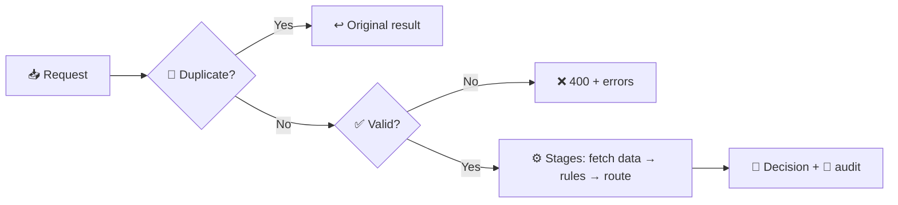

# 🧭 Configurable Workflow Decision Platform

A generic decision engine where business workflows (loan approval, vendor approval, claims, onboarding) are **JSON config files**. Each request is validated, run through stages of rules, and gets a decision with a full audit trail explaining why.

✅ Approve · ❌ Reject · 🔁 Retry · 🧑‍⚖️ Manual review

✏️ Changing a threshold, rule, stage or whole workflow is a **config edit, not a code change**.

📄 More detail: [ARCHITECTURE.md](ARCHITECTURE.md) (design, trade-offs, scaling) · [examples/](examples/README.md) (real decision explanations) · [configs/](configs/) (workflow definitions)

## 🧠 How it works



The duplicate check runs first, so a replayed key gets its original answer even after the rules or schema change. Each stage runs in its own transaction, so failures roll back cleanly and retries resume from the failed stage.

## 🏆 Hackathon requirements

| Requirement | Where |
|---|---|
| 📥 Input validation (JSON Schema) | `validator.py` |
| 📏 Rules: mandatory, threshold, conditional, multi-stage | `rule_engine.py` |
| ⚙️ Workflow execution and state history | `workflow_engine.py`, `store.py` |
| 📜 Audit trail and explanations | `explain.py`, `/audit`, `/explanation` |
| 🛡️ Retries, rollback, crash recovery, idempotency | `dependencies.py`, `workflow_engine.py`, `service.py`, `store.py` |
| 🌐 Simulated dependencies with fault injection | Mock credit bureau and vendor registry (`dependencies.py`) |
| ✏️ Config changes with versioning | `configs/`, `config_loader.py`, `POST /workflows/reload` |
| 🧪 Tests and 📈 scaling notes | `tests/`, [ARCHITECTURE.md](ARCHITECTURE.md) |

## 🚀 Quick start

Requires Python 3.10+.

```bash
python -m venv .venv && source .venv/bin/activate   # Windows: .venv\Scripts\activate
pip install -r requirements.txt
pytest                         # run tests (~10 seconds)
uvicorn app.main:app --reload  # API docs at http://127.0.0.1:8000/docs
```

## 🎮 Try it

```bash
curl -s -X POST http://127.0.0.1:8000/workflows/loan_approval/requests \
  -H "Content-Type: application/json" -H "Idempotency-Key: demo-1" \
  -d '{"applicant_id":"A-1001","pan":"ABCDE1234F","age":30,"annual_income":900000,"amount":500000}'
```

- 🔑 Send it again: same result, `"duplicate": true`, HTTP 200 instead of 201, nothing re-evaluated.
- 🗣️ See why: `GET /requests/<request_id>/explanation`
- 🎯 Other outcomes: `A-1002` → ❌ rejected (score 610), `A-1003` → 🧑‍⚖️ manual review (score 675).
- 💥 Simulate an outage with `POST /simulate/dependencies/credit_bureau/faults` (`{"fail_next":3}`), then recover with `POST /requests/<id>/retry`.
- 🧑‍⚖️ Resolve a review with `POST /requests/<id>/review` (`{"decision":"APPROVED","reviewer":"asha.k"}`). Approval clears that stage and the workflow continues. A required check whose service never answered cannot be approved, only rejected.
- ✏️ Edit `ELIG-INCOME` in `configs/loan_approval.json`, bump `"version"`, and call `POST /workflows/reload`. Old decisions keep their original version in the audit trail.

## ⚙️ Configuration

Each workflow is one JSON file with an `input_schema` and a list of `stages`. A rule looks like:

```json
{ "id": "CREDIT-MIN", "type": "threshold",
  "field": "deps.credit_bureau.score", "op": ">=", "value": 650 }
```

Misspelled keys are refused at load time with a suggestion. A rule whose data is missing never passes: it fails or goes to a human. Full reference: [ARCHITECTURE.md §6](ARCHITECTURE.md#6-configuration-model).

## 🔌 API

| Endpoint | Purpose |
|---|---|
| `POST /workflows/{workflow}/requests` | Submit a request (optional `Idempotency-Key` header) |
| `GET /requests/{id}` · `/explanation` · `/audit` | State, explanation, full audit |
| `POST /requests/{id}/retry` · `/review` | Retry a parked request, resolve a manual review |
| `GET /workflows` · `POST /workflows/reload` | List or reload workflows |

Status codes: `201` new · `200` duplicate · `202` duplicate still processing · `400` invalid input · `404` not found · `409` key conflict or action not allowed. Full list at `/docs` when the server is running.

## 📁 Project layout

```
app/        🧩 API, engine, rules, storage, dependencies
configs/    📋 workflow definitions
tests/      🧪 test suite
examples/   🗣️ decision explanations
```

🔧 Settings: `DECISION_CONFIG_DIR`, `DECISION_DB_PATH`, `DECISION_ENABLE_SIMULATION` (`0` removes the fault endpoint), `DECISION_STALE_AFTER_SECONDS` (default 30).

🧹 Delete `decisions.db` to reset the database.
